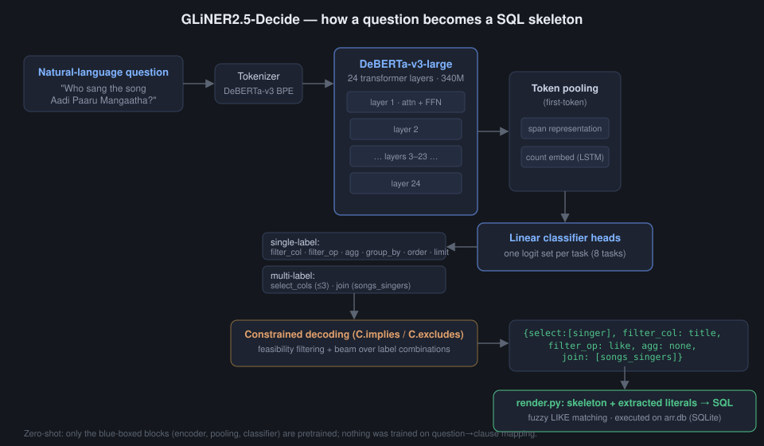
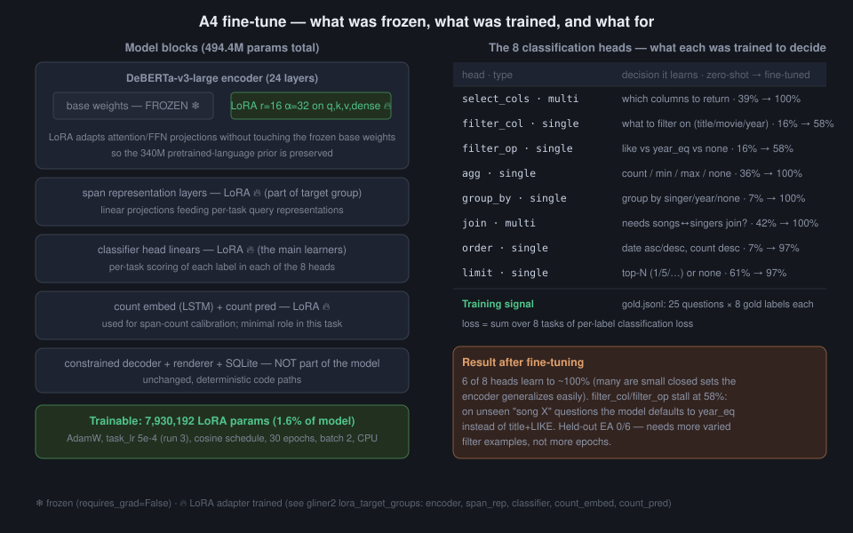
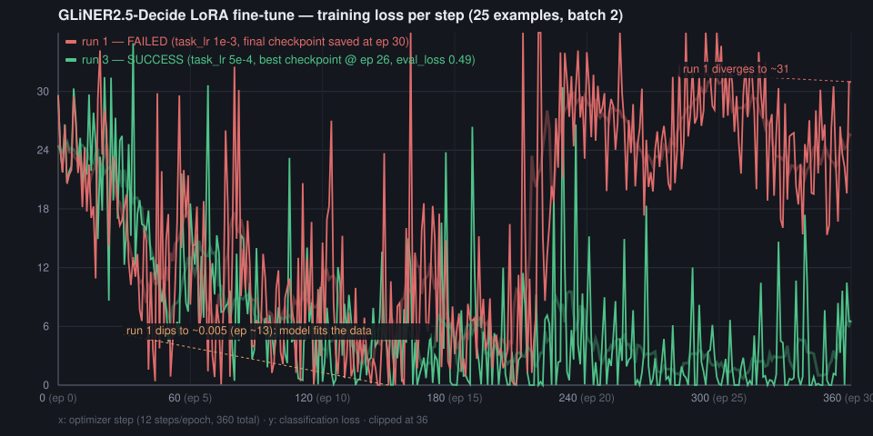

# Why we taught a 300M-parameter model to route SQL questions — and what each fine-tuning stage bought

*How we took a small classifier from 0% to 96.6% on a text-to-SQL task, and
why the remaining 3.4% is a router problem, not a model problem.*

## Why this experiment exists

Our app answers natural-language questions about a music database —
playback singers, film soundtracks, release years. Two very different kinds
of questions arrive:

- **"Who sang Kun Faya Kun?"** — the database contains the answer; a small
  set of SQL patterns can retrieve it.
- **"Which of Ilaiyaraaja's singers also sang for A. R. Rahman, ranked by
  awards?"** — the database alone cannot answer this; it needs a full LLM
  with reasoning, or a "we can't answer that" reply.

Every user question must go to the right place. A full LLM is slow and
costly; a local model is fast and free but narrow. So the goal of this
experiment was **to build a reliable routing signal**: a cheap model that
answers a question when it can — and, just as importantly, *knows* when it
can't, so the question gets escalated to an LLM instead of silently
returning garbage.

The signal we bet on: the small model decomposes each question into eight
classification decisions (a "[skeleton](#skeleton)", [defined in the
glossary below](#skeleton)), and the decision is correct only if **every**
decision is right. If we can measure per-decision accuracy, we get a
confidence story: questions whose shape the model handles near-perfectly
get answered locally; shapes with known weak spots get routed away. The
experiment measures how much fine-tuning data is needed to make that
confidence real.

This post is self-contained: every technical term is explained at first
use, and again in the [glossary](#glossary) at the bottom, which each term
links to. If you've read the raw reports (`REPORT.md`, `REPORT-EXP1.md`)
you've seen the numbers; here we unpack what they mean.

## The architecture

The underlying model is
**[GLiNER2.5-Decide](#gliner25-decide)** — a small
[encoder](#encoder) model (roughly 300M parameters) that does not generate
SQL. It makes **8 classification decisions** (each one a
"[head](#head)") about a question's structure, and a
[renderer](#renderer) turns those decisions into real SQL run against
per-composer databases.

Training is [LoRA fine-tuning](#lora-low-rank-adaptation) — we don't touch
the base model's weights, only a small set of injected adapter weights,
which is why a single laptop-class GPU can do it.

### Why 8 heads — and no more

Each decision is called a **head**: a classification over the
*same input* — the question text plus a frozen list of allowed labels for
that head. The model outputs, for each label, whether it applies.

The 8 heads were chosen to be exactly the set of *structural* choices SQL
forces you to make — nothing that requires free-form generation:

| head | what it decides | labels (simplified) |
|---|---|---|
| `select_cols` | which columns the answer needs | song, singer, movie_name, year, … |
| `filter_col` | which column the WHERE clause targets | none, title, movie_name, year, singer |
| `filter_op` | which filter operator | none, like, year_eq |
| `agg` | what aggregation collapses the rows | none, min, max, count, distinct |
| `group_by` | whether rows are grouped (e.g. per-year counts) | none, year |
| `join` | which tables must be connected | songs_singers, songs_movies, none |
| `order` | sort order of results | none, count_desc, name_asc |
| `limit` | cap on result rows | none, 1 |

Deliberately **excluded** from the model: the filter *values* ("Taare
Zameen Par", "Dhanush", "2006"), which stay as plain strings extracted
from the question, and any SQL syntax — the renderer writes that. Keeping
the model purely on closed classification choices was the central design
decision: it keeps every decision verifiable, and it makes "all decisions
correct" a checkable signal for routing (see the framing at the top).

Concretely, for *"List the playback singers featured on
Shankar-Ehsaan-Loy's soundtrack for the film Taare Zameen Par"*:

| head | output for this question |
|---|---|
| `select_cols` | `[singer]` — what the answer should contain |
| `filter_col` | `movie_name` — the WHERE clause targets the film column |
| `filter_op` | `like` — substring match (see [filter](#filter)) |
| `agg` | `none` — plain rows |
| `group_by` | `none` |
| `join` | `[songs_singers]` — the singer table joins the song table |
| `order` | `none` |
| `limit` | `none` |

The renderer then combines the 8 decisions into SQL:
`SELECT s2.singer FROM songs_se l1 JOIN singers_se s2 … WHERE
l1.movie_name LIKE '%Taare Zameen Par%'`. Two heads the question never
mentions (`group_by`, `order`) still have to be right — a spurious
`group_by=year` silently corrupts the answer.

### The skeleton

The [skeleton](#skeleton) is the full set of 8 head decisions at once —
the query's shape, before any values are filled in. It's the
"select-what, filtered-by, aggregated-how, sorted-by" blueprint. Getting 7
of 8 heads right is worth nothing: one wrong head and the rendered SQL
answers a different question. So the strictest metric we track is
**[exact skeleton accuracy](#exact-skeleton)** — all 8 heads correct
simultaneously. It went 0% → 54.8% → 84.5% across the fine-tuning stages,
and it's the number that most directly predicts whether the final SQL
answers the question asked — which is what makes it usable as a routing
signal.

## The filter — the heads that require understanding

Two heads decide the WHERE clause: `filter_col` (which column the question
constrains) and `filter_op` (which operator). The three operators:

- `like` — substring/pattern match. "…featured on the film *Taare Zameen
  Par*" → `filter_col=movie_name, filter_op=like` → `WHERE movie_name LIKE
  '%Taare Zameen Par%'`.
- `year_eq` — exact year. "…songs Kailash Kher sang in 2006" →
  `filter_col=year` → `WHERE substr(release_date,1,4) = '2006'`.
- `none` — no filter at all. "How many singers has X collaborated with?"
  has no WHERE clause — the filter decision is `none/none`.

The [filter decision](#filter) was the experiment's main bottleneck. Every
other head can be decided from surface patterns ("how many…" → `count`);
the filter heads must read the **[slot type](#slot-type)** of an entity in
the question — is "X" a song title, a film name, or a year? The same
string can fill either slot: "Maasi Maasam" filters on the song column,
"Taare Zameen Par" on the film column — and nothing in the string itself
says which. That's why it needed orders of magnitude more training data
than the other heads.

## Training: data and curves

"Scaled" refers to the corpus scale-up: the seed set was 25 hand-written
training questions ([`gold.jsonl`](gold.jsonl)), which we grew to **2,076
machine-generated, DB-verified entries** across 6 composers
([`gold-multi-scaled.jsonl`](../multi-composer-qa/gold-multi-scaled.jsonl)),
split 1,703 train / 373 test by a leakage-safe entity-grouped split
([`exp1_split.json`](../multi-composer-qa/results/exp1_split.json)). Every
generated query's reference SQL was executed against the real database to
confirm the stored answer is correct. The multiplier mattered: 25 examples
taught the model the *mechanism* of classification but left the filter
head with ~6 filter patterns to memorize; 1,703 gave it enough variety to
read slot type from the question.

Training went through the usual divergence problems — the first run (task
learning rate 1e-3) blew up, the third run (5e-4) converged:

## What each stage bought

The stage names in the reports compress two independent knobs. Unpacked:

- **"scaled bare (a1redo)"** = the full 1,703-example training set, model
  trained with **bare labels only** (just `title`, `year`, `like` — no
  explanations attached to the labels).
- **"scaled + descriptions (a2desc)"** = same 1,703-example training set,
  but every label carries a short natural-language **description** during
  *training* (e.g. `title: "song title"`, `like: "substring/pattern
  match"`), so the model learns what each label means rather than its
  token identity.
- **"scaled + rebalanced"** = the same 1,703-example training set with its
  class mix edited before training: the dominant year-filter templates
  (449 of 2,076) were capped at 150, and the underrepresented classes got
  extra copies plus 112 "contrastive pairs" — the same entity string as a
  song title in one question and a film name in another, forcing the
  model to read slot type instead of memorizing the token. The intent was
  to fix `limit` and agg without more data; the result was a trade:
  exact skeleton 0.445 → 0.694 (`limit` fixed) but agg 0.847 → 0.697 —
  every sample added to one class is supervision taken from the others,
  so it was abandoned in favor of label descriptions.
- **"rebalanced"** = short for the above intervention (see
  [Rebalanced](#rebalanced) in the glossary).

| stage | train size | filter decision | exact skeleton | [EA](#ea-execution-accuracy) |
|---|---|---|---|---|
| zero-shot (no fine-tune) | 0 | ~0.16 | 0.000 | 0.00–0.03 |
| 25-example LoRA | 25 | 0.581 | 0.548 | 0.419 seen / 0.000 held-out |
| scaled, bare labels (a1redo) | 1,703 | 0.979 | 0.445 | 0.867 |
| scaled + rebalanced | 1,954 | 0.952 | 0.694 | 0.825 |
| scaled + label descriptions (a2desc) | 1,703 | 0.979 | 0.845 | 0.870 |
| a2desc + first-family rule | 1,703 | 0.979 | 0.845 | **0.966** |

*(zero-shot = the base model with no fine-tuning at all; 25-example
figures are from `REPORT.md`'s tables; scaled-stage figures are on the
373-question held-out test set with corrected inference constraints.)*

Per-head accuracy on that same held-out test set:

| head | 25-example LoRA | scaled, bare labels | **scaled + descriptions** |
|---|---|---|---|
| select_cols | — | 1.000 | 0.995 |
| group_by | 0.065 | 1.000 | 1.000 |
| order | 0.323 | 1.000 | 1.000 |
| join | 0.419 | 0.997 | 0.997 |
| limit | 0.613 | 0.579 | 1.000 |
| agg | 0.355 | 0.847 | 0.858 |
| filter_col | 0.161 | 0.979 | 0.979 |
| filter_op | 0.161 | 0.979 | 0.979 |
| **exact skeleton (all 8)** | 0.000 | 0.445 | **0.845** |

Reading it, with the terms unpacked:

- The **pattern-copying heads** (`group_by`, `order`, `join` — heads whose
  decision follows a recognizable phrase like "sorted by" or "how many")
  go from coin-flip to near-perfect once data scales 100×.
- The **filter heads** (`filter_col`, `filter_op`) — the two heads that
  must read slot type — go from 0.161 (a coin flip among the operator /
  column choices) to 0.979.
- **`agg`** — the head deciding whether rows collapse into a min/max/count
  — stays the hardest (~0.86), and is exactly where the
  [first-family rule](#first-family) picks up below.

### Takeaways

1. **Fine-tuning is necessary, not optional.** Zero-shot never produces a
   single correct skeleton (0/31 questions) — all 8 heads must be right at
   once, so per-head scores of 16–74% are moot.
2. **25 examples buy the mechanism, not the coverage.** EA 0 → 0.419 on
   seen questions, but held-out filter decisions stay 0/6.
3. **100× more data buys the filter decision.** filter 0.581 → 0.979 —
   but only after the inference-time constraint set was corrected; the
   naive constraints had masked the gain.
4. **Descriptions add without taking away.** Training *with* label
   descriptions keeps filter at 0.979 and fixes both `limit` and `agg` →
   skeleton 0.845. Inference-only descriptions, by contrast, were strongly
   negative (skeleton 0.694 → 0.343) — a train/inference schema mismatch.
5. **The residual gap is one template family, best fixed outside the
   model.** Two retrains regressed other heads; the deterministic scorer
   rule closes it: EA 0.966.

## The failure that remains — and what it says about routing

### The agg head

[Agg](#agg) is the aggregation head: what function collapses the matched
rows. `min` (earliest year — "when did X *first* sing?"), `max` (latest),
`count` ("how many singers?"), `distinct` (unique list), `none` (no
aggregation — just the rows). This head caused the last big failure
family: 34 of 60 end-to-end failures were one template family where the
model returned the whole date list instead of the earliest year —
`agg=none` instead of `agg=min` — producing "2023-03-08 00:00:00" where
the gold answer was "2023".

### The first-family

That template is the [first-family](#first-family): questions like

> "In which year did Dhanush first sing for Ilaiyaraaja?" →
> `SELECT MIN(substr(release_date,1,4)) ... WHERE singer LIKE '%Dhanush%'`
>
> "When did Suchith Suresan first sing for Sushin Shyam?" → same shape,
> `agg=min`.

It's called "first" because the question word *first* implies "earliest
year" = `agg=min`. It was held out of training entirely (0 train / 41 test
questions) as a generalization probe — and the probe failed: the model
never learned "first ⇒ min". Two retrains to teach it (204 synthetic
entries each) both fixed the family but broke other heads elsewhere; the
fix that won was a deterministic rule at inference time: questions
matching the family's phrasings ("first sing", "first appear", "first
work as", …) get the canonical family shape imposed by the scorer. That
single rule took EA from 0.870 to 0.966.

### What this means for the routing goal

Back to the opening question: can this model reliably signal when a
question is answerable by it vs needing an LLM? The experiment's answer is
a qualified yes, with a precise shape:

- The model *is* a usable router for everything it trained on: per-head
  accuracy ≥ 0.98 on all pattern heads and the filter pair means
  skeleton-correct questions get correct SQL, and EA 96.6% is what a user
  sees.
- The failure mode is *not* random: it is concentrated in identifiable
  question shapes (`agg` decisions, unseen "first"-phrasings). That means
  the routing signal can't be "the model's own confidence" — it has to be
  **shape-aware**: known-weak families route to the LLM or to a
  deterministic override; the rest answer locally.
- Concretely: exact-skeleton correctness + a small whitelist of
  hard-family overrides gets you to 96.6% locally. Anything the model
  can't map onto its 8 heads — or that fails a post-render sanity check —
  is the trigger for escalation. That was the deliverable this experiment
  set out to validate.

## Glossary

Every term used above, alphabetically. Each linked term in the post points
here.

### GLiNER2.5-Decide

The base model: a small (~300M) [encoder](#encoder)-based model fine-tuned
to make closed-set [classification](#classification) decisions over a text
input, rather than generate free text.

### Encoder

A transformer model that reads the input once and produces per-token /
per-label scores, unlike a decoder that generates output token by token.
Much faster and smaller; can't write SQL directly.

### Classification

Picking one (or several) labels from a fixed list. "Is this question a
`count` question? yes/no" — not "write a query".

### Head

One classification decision, with its own frozen label list, applied to
the same question input. Our model has 8 heads.

### LoRA (Low-Rank Adaptation)

A fine-tuning method that freezes the base model's weights and trains only
small injected adapter matrices. Cheap (fits in a laptop GPU) and
swap-friendly: one base model, many adapters.

### Adapter

The set of LoRA weights produced by one fine-tuning run. "the a2desc
adapter" = the run trained on 1,703 examples with label descriptions.

### Renderer

Deterministic code that combines the 8 head decisions + extracted filter
values into real SQL. No model involved.

### Skeleton

The full set of 8 head decisions at once: the query's shape before values
are filled in.

### Exact skeleton

The strictest metric: all 8 heads correct simultaneously. One wrong head
⇒ wrong SQL.

### Filter

The WHERE clause decision: which column the question constrains
(`filter_col`) and with which operator (`filter_op`: `like` substring
match, `year_eq` exact year, `none`).

### Slot type

What *kind* of thing an entity in the question is (song title vs film name
vs year). The same string can fill either slot, so deciding the filter
requires reading the question's meaning, not the string.

### Agg

The aggregation head: what function collapses the matched rows — `min`
(earliest), `max` (latest), `count`, `distinct` (unique list), or `none`
(plain rows).

### First-family

The "in which year did X first sing for Y" template, where "first" implies
`agg=min`. Held out of training as a generalization probe; failed, and was
fixed by a deterministic inference-time rule.

### Scaled

The corpus scale-up from 25 hand-written questions to 2,076
machine-generated, DB-verified entries (1,703 train / 373 test).

### Rebalanced

A training-data intervention: capped the dominant year-filter templates at
150 and oversampled weak classes plus 112 "contrastive pairs" (same entity
string as song title in one question, film name in another). Fixed
`limit` but hurt `agg` — rebalancing trades heads, it doesn't add
capability.

### Label descriptions

Short natural-language explanations attached to labels at *training* time
(`like: "substring/pattern match"`). Helped everywhere; the same
descriptions applied only at inference time actively hurt (train vs
inference schema mismatch).

### EA (execution accuracy)

The end-to-end metric: run the rendered SQL against the real database and
compare the result to the gold answer. The only metric that measures what
a user actually sees. Final: **342/354 = 96.6%**.

### Zero-shot

Evaluating the base model with no fine-tuning at all.

### Held-out test set

The 373 questions the model never saw during training (entity-grouped,
leakage-safe split), used for all scaled-stage numbers.

### a1redo / a2desc

Run names: a1redo = scaled training with bare labels; a2desc = scaled
training with label descriptions.

Full details: `REPORT.md` (zero-shot and 25-example stages) and
`REPORT-EXP1.md` (scaled stages, ablations, failure attributions).
